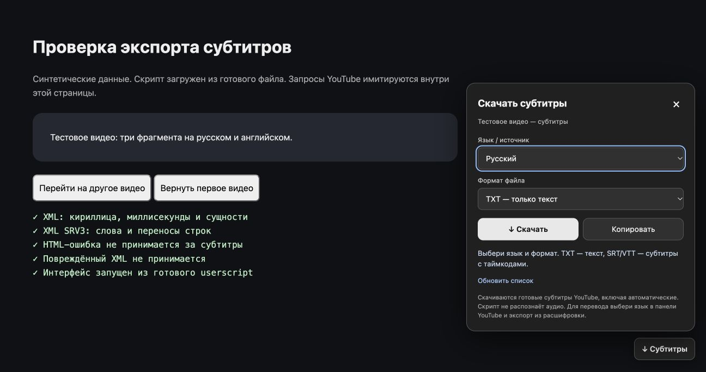

# YouTube — скачать субтитры и текст

Скрипт для **Tampermonkey в Chrome**. Добавляет на страницы YouTube кнопку **«↓ Субтитры»**: выбор языка, скачивание текста и субтитров с таймкодами.

**[Установить скрипт](https://raw.githubusercontent.com/omiusgm/youtube-subtitles-tampermonkey/main/youtube-subtitles.user.js)** · [Исходный код](youtube-subtitles.user.js) · [Подробная инструкция](INSTALL.ru.txt)

## Установка

1. Установите [Tampermonkey из официального источника](https://www.tampermonkey.net/), если расширения ещё нет.
2. Нажмите **«Установить скрипт»** выше. В открывшемся окне Tampermonkey проверьте код и нажмите **Install / Установить**.
3. Перезагрузите вкладку YouTube с роликом.

Если вместо установки открылся текст: скопируйте весь код, откройте Tampermonkey → **«Создать новый скрипт»**, замените шаблон и сохраните: **⌘S** на Mac или **Ctrl+S** на Windows.

Если скрипты вообще не запускаются, проверьте настройку **Allow User Scripts / Разрешить пользовательские скрипты** у расширения Tampermonkey в Chrome. [Официальная справка](https://www.tampermonkey.net/faq.php?q=Q209).

## Использование

Откройте видео → нажмите **«↓ Субтитры»** справа внизу → выберите язык и формат → **«↓ Скачать»**.

| Формат | Содержимое |
| --- | --- |
| TXT | Текст без таймкодов; название, ссылка и язык в начале файла |
| TXT с таймкодами | Время начала и текст каждого фрагмента |
| SRT | Субтитры для видеоплееров и монтажа |
| VTT | Субтитры для веб-плееров |

**«Копировать»** переносит подготовленный текст в буфер обмена. Если браузер запрещает копирование, текст выделяется в поле: нажмите ⌘C / Ctrl+C.

Если YouTube вернул пустой ответ:

1. Включите **CC** в плеере и выберите нужный язык.
2. В меню скрипта нажмите **«Обновить список»** и повторите скачивание.
3. Другой вариант: описание ролика → **«Показать текст видео»**. Дождитесь текста и выберите в скрипте **«Из расшифровки YouTube · язык её панели»**. Язык для этого режима выбирается в самой панели YouTube.

## Возможности и ограничения

- Скачиваются существующие субтитры, в том числе автоматические. Распознавания аудио в скрипте нет.
- Поддерживаются страницы обычных видео, Shorts и записей трансляций. Полный экспорт продолжающегося эфира откладывается до его завершения и обработки.
- При запросе через плеер субтитры могут ненадолго включиться. Скрипт пытается восстановить прежнюю дорожку, если зритель не менял её сам.
- Пустой ответ, обнаруженная неполная расшифровка и ответ от предыдущего видео не сохраняются.
- Если в расшифровке нет времени окончания фрагмента, используется начало следующего; для последнего такого фрагмента — 2 секунды.
- Если у видео нет доступных субтитров или расшифровки, скачать текст нельзя. Точность зависит от автора и YouTube.
- Внутренние методы YouTube могут меняться. Работа на всех реальных роликах не гарантируется.

## Данные и обновления

Нет сторонних библиотек, сервиса распознавания или платных API. Скрипт выполняется на `youtube.com`, а запросы за субтитрами ограничены текущим origin YouTube.

Текст и временные адреса запросов хранятся в памяти вкладки. При смене видео кеш сбрасывается. Файлы сохраняются локально средствами Chrome. Внешнему сервису расшифровка не отправляется.

В заголовке указаны адреса обновления из **этого репозитория**. Проверка и установка обновлений управляются настройками Tampermonkey.

## Проверка

Версия **1.0.0**, 24 октября 2026 года:

- 13 регрессионных тестов: JSON3, VTT, время, имена файлов, языки, расшифровки и неполные ответы.
- В Chrome на синтетическом стенде проверены XML, интерфейс, скачивание TXT/SRT/VTT с чтением сохранённых файлов, получение автосубтитров через плеер и восстановление его настроек.
- Проверен переход на другое видео во время запроса: прежний текст не выгружается.

**Получение субтитров с реального YouTube в этой проверке не подтверждено.** Стенд имитирует ответы и адрес страницы; это не полноценная проверка внутреннего API YouTube.

Запуск тестов — Node.js 18 или новее, без установки зависимостей:

```sh
node --test tests/core.test.cjs
```

Локальный стенд — Python 3:

```sh
python3 tests/serve.py
```

Откройте напечатанный адрес. Сервер слушает только `127.0.0.1`; реальные аккаунты и запросы YouTube не используются. Остановка — Ctrl+C.

## Вид меню на тестовой странице


